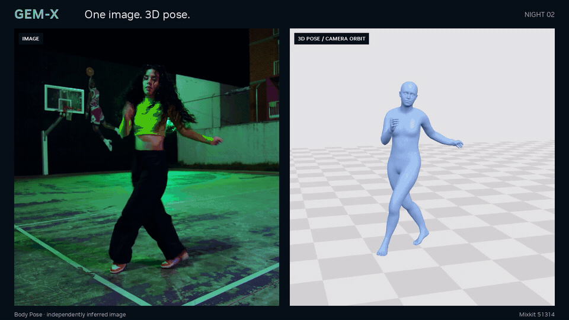
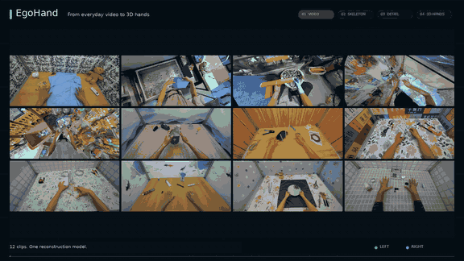

<h1 align="center">GEM-X: Full-Body and Hand Pose Estimation from Image and Video</h1>

<p align="center">
  <em>Unified body pose, hand pose, and temporal motion estimation with SOMA</em>
</p>

<p align="center">
  <a href="https://research.nvidia.com/labs/dair/gem/"></a>
  <a href="#license"></a>
  <a href="https://www.python.org/"></a>
  <a href="https://pytorch.org/"></a>
  <a href="https://developer.nvidia.com/cuda/toolkit"></a>
</p>

<p align="center">
  <a href="#quick-start">Quick Start</a> ·
  <a href="#pretrained-models">Pretrained Models</a> ·
  <a href="#evaluation">Evaluation</a> ·
  <a href="#training--evaluation">Training &amp; Evaluation</a> ·
  <a href="#documentation">Documentation</a>
</p>

---

<p align="center">
  <a href="assets/gemx_overview.mp4">
    
  </a>
  <br>
  <b>Full-body pose and motion from images and video.</b>
  <br>
  <sub>A 13-second full-body showcase, ending with motion retargeted to Unitree G1. Click to watch in 720p.</sub>
</p>

<p align="center"><sub>Body Motion views use Contact/IK postprocessing. <a href="#hand-showcase">Hand teaser</a> · <a href="docs/DEMO.md#readme-showcases">Showcase notes and source credits</a></sub></p>

<a id="hand-showcase"></a>
<p align="center">
  <a href="assets/hand_pose.mp4">
    
  </a>
  <br>
  <b>Detailed hand pose from images and video.</b>
  <br>
  <sub>The full 24-second EgoHand 1.0-GA showcase. Click to watch in 720p.</sub>
</p>

## Overview

GEM-X provides **Body Pose**, **Hand Pose**, and **Body Motion** in a shared
framework for inference, training, and evaluation. Body and Hand Pose reconstruct
3D geometry from individual images. Body Motion uses temporal context to estimate
camera-space and world-space human motion from monocular video. All three models
use [SOMA](https://github.com/NVlabs/SOMA-X) geometry.

## Key Features

- **Full-body and hand reconstruction** — dedicated image models for body pose
  and detailed left and right hand geometry.
- **Temporal body motion** — person tracking, 2D keypoint observations, and Body
  Pose features feed a temporal model that predicts camera-space and world-space motion.
- **Flexible hand inputs** — supplied boxes or RT-DETR detection, ego/exo
  processing profiles, optional tracking and smoothing, and calibrated camera adapters.
- **Robotics showcase** — recovered SOMA motion retargeted to Unitree G1 with [SOMA Retargeter](https://github.com/NVIDIA/soma-retargeter); see the [application demo](docs/DEMO.md#g1-retargeting-showcase).
- **Training and fine-tuning** — train Body Pose, Hand Pose, and Body Motion;
  fine-tune pretrained weights or resume a complete training checkpoint.
- **Visualization and evaluation** — render saved predictions, apply optional
  contact/IK correction, and evaluate with native Hand metrics or custom evaluators.

## Models and Inference Modes

There are **three models and four inference modes**. The command identifies the
model family and input type; `--task` selects body or hand.

| Command | Task | Prediction |
| --- | --- | --- |
| `pose-image` | `body`, `hand` | Body or Hand Pose from one image |
| `pose-video` | `body`, `hand` | Body or Hand Pose independently on each video frame |
| `motion-video` | `body` | Temporal Body Motion with automatic video preprocessing |
| `motion-cache` | `body` | Temporal Body Motion from cached features and observations |

`pose-video` runs the image model frame by frame. Hand tracking and smoothing are
optional processing stages; learned temporal prediction is provided by Body Motion.
See [Model Overview](docs/MODEL_OVERVIEW.md) for architecture and output conventions.

## Quick Start

### 1. Install

Use Python 3.10 or newer and install a PyTorch 2.10 build for your device. From
this checkout:

```bash
python -m venv .venv
source .venv/bin/activate
python -m pip install --upgrade pip
# Install the PyTorch build for your CPU or CUDA environment before this step.
python -m pip install -e '.[video,hand]'
```

Install FFmpeg for video processing. For the rendering commands below, install
`python -m pip install -e '.[render]'` and the
[rendering dependencies](docs/INSTALL.md#rendering-dependencies) in a Linux x86-64
environment. See [Installation](docs/INSTALL.md) for CPU/CUDA setup, Docker,
ARM64 inference, and optional dependencies.

### 2. Prepare weights and assets

Place the required checkpoints locally and obtain the matching SOMA 0.3.3 geometry
assets. The Python runtime is installed with GEM; model weights and geometry
assets are supplied separately. Follow [Pretrained Models](docs/PRETRAINED_MODELS.md)
for the files needed by each model.

### 3. Run inference

**Body Pose — image**

Supply camera intrinsics and square bounding boxes in
[`boxes.json`](docs/DEMO.md#body-image):

```bash
gem-infer pose-image --task body --input image.jpg --boxes boxes.json \
  --release body --checkpoint weights/body_s240000.ckpt \
  --soma-assets /path/to/soma-assets --device cuda --output body.pt
gem-render --task body --input body.pt --output-dir outputs/body
```

**Hand Pose — video**

Use the [EgoHand checkpoint](https://huggingface.co/nvidia/EgoHand-v1) and a local
[RT-DETR Hand Detector](https://huggingface.co/nvidia/RT-DETR-Hand-Detector-v1):

```bash
gem-infer pose-video --task hand --input video.mp4 \
  --release hand --checkpoint weights/egohand_s060000.ckpt \
  --hand-detector weights/hand_detector.onnx \
  --soma-assets /path/to/soma-assets --device cuda --output hands.pt
gem-render --task hand --input hands.pt --output-dir outputs/hand
```

The default `--hand-view exo` processes detections independently per frame.
For the camera wearer's hands, add `--hand-view ego` to enable video tracking,
crop stabilization, and parameter smoothing. Supplied boxes and calibrated
pinhole/fisheye inputs are covered in the [Hand inference guide](docs/DEMO.md#hand-image-or-framewise-video).

**Body Motion — video**

Configure the local model paths and 2D keypoint detector identifier in
[`body_video_native77.yaml`](docs/configs/body_video_native77.yaml), then run:

```bash
gem-infer motion-video --task body --input video.mp4 \
  --config docs/configs/body_video_native77.yaml --device cuda \
  --postprocess --soma-assets /path/to/soma-assets --output motion.pt
gem-render --task body --input motion.pt --soma-assets /path/to/soma-assets \
  --device cuda --output-dir outputs/motion
```

Body Motion produces camera and world views. This example uses `--postprocess`
for the Contact/IK correction shown in the films; omit it for raw predictions.
The [Inference guide](docs/DEMO.md) explains input formats, output fields, cached
prediction, camera handling, and postprocessing.

## Pretrained Models

Download the weights for your task from the following Hugging Face repositories:

| Model | Checkpoint | Configuration | Weight source |
| --- | --- | --- | --- |
| Body Pose | `body_s240000.ckpt` | `body` | [nvidia/GEM-X](https://huggingface.co/nvidia/GEM-X/tree/main) |
| Hand Pose | `egohand_s060000.ckpt` | `hand` | [nvidia/EgoHand-v1](https://huggingface.co/nvidia/EgoHand-v1) |
| Body Motion | Native77 final775 | [Native77 configuration](docs/configs/body_video_native77.yaml) | [nvidia/GEM-X](https://huggingface.co/nvidia/GEM-X/tree/main) |

Hand weights are distributed by the official EgoHand repository; access is
managed there. See the [download commands](docs/PRETRAINED_MODELS.md#download-checkpoints).

Body Motion uses Body Pose image features and **77-point 2D keypoint observations**.
Native29 is an alternate layout for separately trained weights.

See [Pretrained Models](docs/PRETRAINED_MODELS.md) for checkpoint availability,
asset requirements, matching detector identifiers, and compatibility details.

## Evaluation

### GEM-pose · Body Pose

Single-frame results for the released `body_s240000.ckpt`. Errors are in
millimeters; lower is better.

| Dataset | MPJPE ↓ | PA-MPJPE ↓ | PVE ↓ |
| --- | ---: | ---: | ---: |
| 3DPW | 62.20 | 39.56 | 72.89 |
| EMDB-1 | 67.83 | 43.14 | 80.27 |

### GEM-motion · Body Motion

EMDB-2 results use **original ViTPose**, the released **native77 final775**
checkpoint and **Contact/IK postprocessing enabled**. The benchmark uses
provided camera intrinsics and camera rotations. Lower is better.

| Dataset | W-MPJPE₁₀₀ (mm) ↓ | WA-MPJPE₁₀₀ (mm) ↓ | RTE (%) ↓ | Jitter score ↓ | Foot sliding (mm) ↓ |
| --- | ---: | ---: | ---: | ---: | ---: |
| EMDB-2 | 267.20 | 112.76 | 2.45 | 34.21 | 4.22 |

Jitter uses the reference reporting scale: mean jerk at 30 Hz divided by 10.
See [evaluation settings and metric definitions](docs/EVAL.md#release-benchmark-results)
for coverage, alignment and aggregation details.

## Training & Evaluation

Install the training and evaluation dependencies:

```bash
python -m pip install -e '.[train,eval]'
```

| Model | Training command | Guide |
| --- | --- | --- |
| Body Pose | `gem-train pose --task body --config training.yaml` | [Body Pose training](docs/POSE_TRAINING.md) |
| Hand Pose | `gem-train pose --task hand --config training.yaml` | [Hand Pose training](docs/HAND_TRAINING.md) |
| Body Motion | `gem-train motion --config training.yaml` | [Motion training](docs/TRAINING.md#body-motion) |

Start with the [Training & Evaluation guide](docs/TRAINING.md) for data preparation
contracts, example configurations, initialization, and full checkpoint recovery.
To fine-tune Hand Pose from `egohand_s060000.ckpt`, use the
[Hand fine-tuning recipe](docs/HAND_TRAINING.md#egohand-fine-tuning).

`gem-eval pose` evaluates Body or Hand Pose; Body Motion uses
`gem-train motion --validate`. Native SOMA25 Hand metrics are included, and Body
Pose and Motion support caller-provided evaluators. See [Evaluation](docs/EVAL.md)
for configuration and metric definitions.

## Documentation

| Guide | Contents |
| --- | --- |
| [Installation](docs/INSTALL.md) | Environment setup, SOMA assets, rendering, and Docker |
| [Pretrained Models](docs/PRETRAINED_MODELS.md) | Checkpoints, detector pairing, and local weight setup |
| [Inference](docs/DEMO.md) | Image, video, and cached inference; camera adapters and visualization |
| [Training & Evaluation](docs/TRAINING.md) | Training entry points, prepared examples, validation, and resume |
| [Body Pose Training](docs/POSE_TRAINING.md) | Body sample format, objectives, and initialization |
| [Hand Pose Training](docs/HAND_TRAINING.md) | Hand fine-tuning, canonical inputs, and objectives |
| [Evaluation](docs/EVAL.md) | Release benchmark results, metric definitions, and custom evaluators |
| [Model Overview](docs/MODEL_OVERVIEW.md) | Model architectures, conditioning, and outputs |
| [Architecture](docs/ARCHITECTURE.md) | Package structure and component responsibilities |

For development setup and contribution guidelines, see [Contributing](CONTRIBUTING.md).

## Production Deployment with NVIDIA AI for Media

For developers looking to integrate 3D body pose estimation into real-world
applications, NVIDIA provides production-ready deployment options through the
[NVIDIA AI for Media](https://developer.nvidia.com/topics/ai/generative-ai/ai-for-media)
SDK and NIM.

- **[NVIDIA 3D Body Pose Estimation – AR SDK](https://catalog.ngc.nvidia.com/orgs/nvidia/maxine/collections/nvar3dbodyposeestimation/-):**
  GPU-accelerated SDK supporting live video processing, enabling continuous 3D
  human body pose and motion estimation.
- **[NVIDIA 3D Body Pose NIM](https://catalog.ngc.nvidia.com/orgs/nim/nvidia/containers/body-pose/-):**
  Containerized inference microservice for integrating 3D body pose estimation
  into scalable video processing workflows.

Explore the full
[NVIDIA Augmented Reality SDK](https://catalog.ngc.nvidia.com/orgs/nvidia/maxine/collections/maxine_ar_sdk/-)
for additional AI-powered video capabilities.

## License

The default source license is [Apache 2.0](LICENSE). Adapted Hand processing
files and the source-camera restoration function retain their
`LicenseRef-OpenMDW-1.1` notices. See [ATTRIBUTIONS.md](ATTRIBUTIONS.md) for the
complete mapping of file and function exceptions, and
[OpenMDW-1.1](LICENSES/LicenseRef-OpenMDW-1.1.txt) for their license.

Model weights, geometry assets, and dependencies retain their respective terms;
see their distributions and the component notices in [ATTRIBUTIONS.md](ATTRIBUTIONS.md).
